# 沟通状态机流转与算法协议 (State Machine Protocol)

本协议定义了 Agent 在与 1688 工厂多轮博弈沟通时的**离散状态流转模型**、**差量催问判定算法**与**异常熔断控制守卫**。

---

## 🔄 状态机流转全景 (Mermaid Flowchart)

```mermaid
flowchart TD
    Start([开始询盘任务]) --> S1[InitInquiry: 组装效果图与全量契约]
    S1 --> S2[DispatchInquiry: 真机下发相册首图与分段话术]
    S2 --> S3[Monitoring: 监听聊天与状态巡检]
    
    S3 --> S4[ChatCapture: 截取最新对话截图]
    S4 --> S5[LocalOCR: 本地 Tesseract 466 DPI 解析]
    S5 --> S6[SlotEvaluation: 10 大槽位语义填充与完成率计算]
    
    S6 --> Decision{核心逻辑判断}
    
    Decision -- "命中负向词: 做不了/交期赶不上" --> CircuitBreak[CircuitBreaker: 触发熔断, 标记淘汰]
    Decision -- "检测到工艺/尺寸限制建议" --> SpecDrift[SpecDrift: 触发规格漂移重算]
    Decision -- "槽位完成率 >= 85% 或核心项齐备" --> Finalizing[Finalizing: 完成比价收敛]
    Decision -- "存在漏答项 且 追问轮次 < 3" --> DeltaFollowUp[FollowUp: 生成差量精准催问]
    Decision -- "追问轮次 >= 3" --> TimeoutState[Timeout: 标记部分报价, 停止催问]
    
    SpecDrift --> DispatchDrift[下发规格变更核价模板]
    DispatchDrift --> S3
    
    DeltaFollowUp --> DispatchFollowUp[真机分段下发差量催问]
    DispatchFollowUp --> S3
    
    CircuitBreak --> End([结束当前工厂对接])
    TimeoutState --> End
    Finalizing --> End
```

---

## 📌 状态节点详细定义 (State Definitions)

### 1. `InitInquiry`（初始契约装配）
- **职责**：提取用户原始物料，将品类、规格、材质、数量、税票、包装、交期打包组合。
- **校验项**：
  - 是否有效果图已推送到手机相册第 1 格；
  - 核心参数是否完整（若用户未给交期或包装要求，自动补齐工业通用缺省值）。

### 2. `DispatchInquiry`（真机下发）
- **执行规范**：
  - 调起 `MediaPicker` 勾选首张图片并发送；
  - 调起 `SegmentedSender`，将全量契约以拟真微信打字节奏逐条下发（单条严格 < 40 汉字，间隙 0.5~0.7s）；
  - 调用 `NavigationGuardian.safe_exit_chat()` 安全退出，防止软键盘拦截。

### 3. `ResponseParsing` & `SlotEvaluation`（响应解析与槽位评估）
- **执行规范**：
  - 调用本地 Tesseract OCR 解析对话文本；
  - 正则清洗提取已回复项，更新槽位字典 `slots`；
  - 计算当前完成度 `completion_rate`，并梳理出未答槽位集合 `missing_slots`。

### 4. `SpecDriftDetected`（规格漂移重算）
- **触发条件**：
  - 厂家反馈中包含限制性建议，如：
    - `“这个颜色渐变只能做数码印，做不了纯织唛”`
    - `“尺寸做8×5排模浪费，建议做7×4.5”`
    - `“只能平织，锁边机进不去”`
- **处理动作**：
  - 锁定新方案名称 `{{NEW_PROCESS_NAME}}`；
  - 派发“规格变更确认话术”，要求对方基于新方案报出大货价与打样费，重置该厂家的基准参照系。

### 5. `FollowUpPrompt`（差量精准催问）
- **触发条件**：`missing_slots` 非空，且当前工厂追问轮次 `rounds < 3`。
- **算法规则**：
  - **严禁重复提问已答项**（例如：若对方已报出单价 1.5，绝不再问“单价多少”）；
  - 提取未回答的槽位，拼装成 1~2 句轻量口语化短句：
    - 若漏掉包装与税点：`“老板单价收到了！包装背卡加多少？普票几个点麻烦也确认下哈”`；
    - 若漏掉退样费与交期：`“另外大货达到多少退打样费？大货交期几天能出？”`。

---

## 🛡️ 三大约束守卫实现规则 (Guardian Rules)

### 1. 停止追问阈值守卫 (Stop Guardian)
- **阈值**：单家工厂最大追问次数固定为 `3 轮`；
- **超时降级**：达到 3 轮仍未获取单价或交期，自动标记为 `PARTIALLY_QUOTED` 或 `TIMED_OUT`，不再继续占用真机和通信资源，确保总盘子高效流转。

### 2. 负向信号快速熔断器 (Rejection Circuit Breaker)
- **熔断关键字**：
  - `做不了`、`做不到`、`发不了`、`来不及`、`赶不上`、`单子排满了`、`不接小单`；
- **动作**：立即终止该工厂状态机，标记为 `REJECTED_BY_FACTORY`，写入淘汰原因，直接执行 `safe_exit_chat()` 并转战下一家。

### 3. 防平台风控脱媒守卫 (Anti-Violation Guard)
- **绝对红线**：禁止在 1688 聊天框直接输入纯 11 位数字手机号；
- **反向引导执行标准**：
  - 话术：`“老板方便留个绿泡泡吗？我加您发AI矢量原文件，咱拉个产品技术群，发一下打样费和翻单减免政策哈”`；
  - 当对方发送拆分数字（如 `1992410` + `6604`）时，`ChatOCR` 自动拼合并清洗入库。
