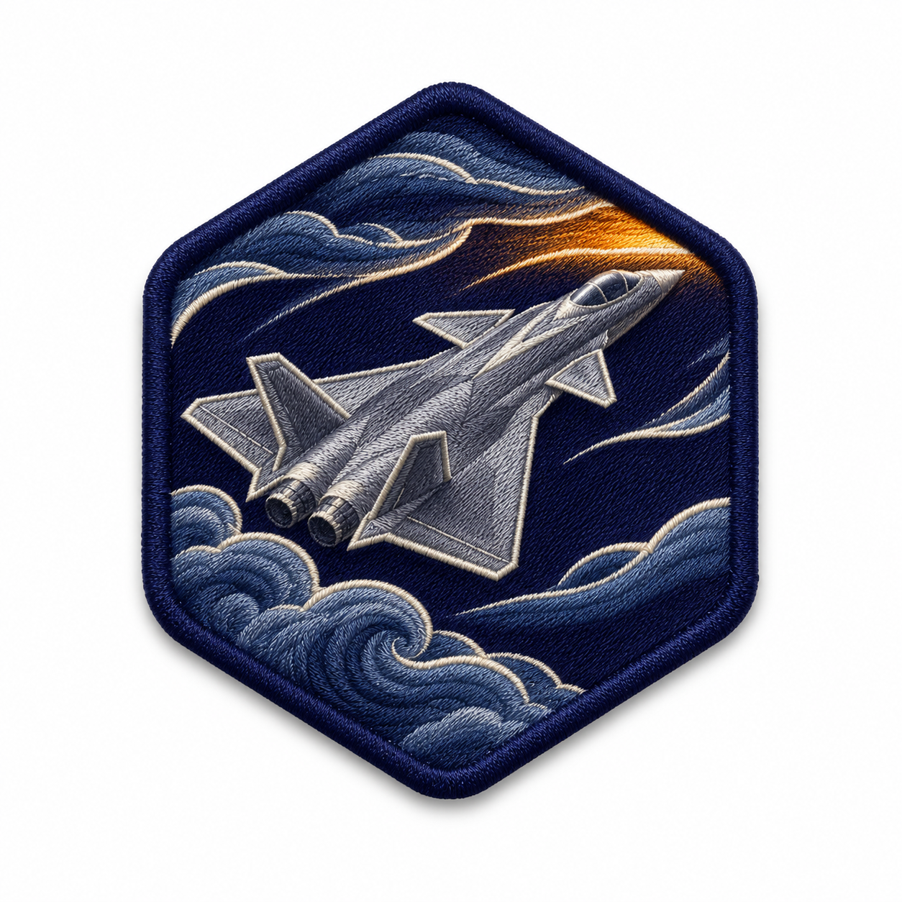
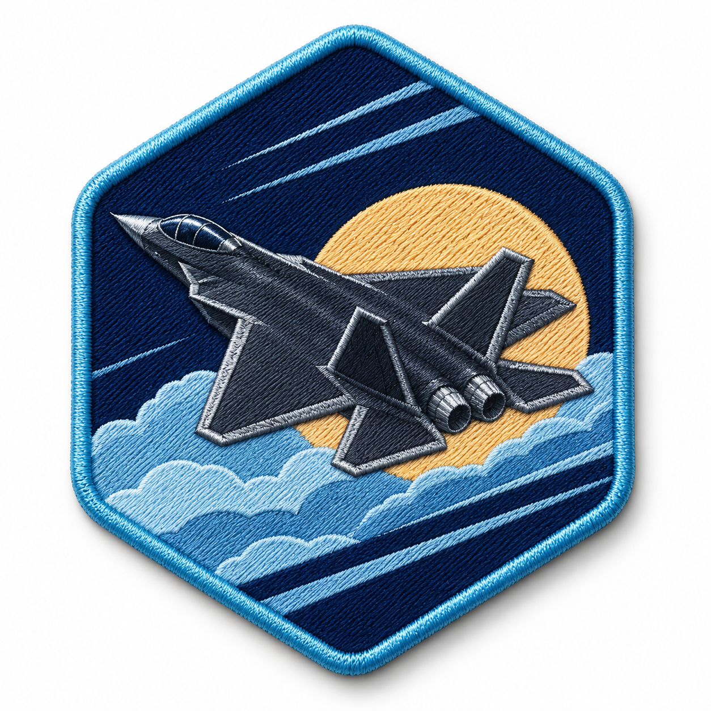

# 航空刺绣设计 · lyz-aircraft-embroidery

把上传的刺绣产品效果图拆成可重组的视觉规则，为中国战机军迷生成原创刺绣章产品图片。默认实际调用宿主AI生图工具；不是只交一段提示词。当前为 v0.1.0 试用版。

```text
使用 $lyz-aircraft-embroidery，参考这批样本设计一枚歼-20刺绣章，
继承参考图的构图张力、冷暖组织和针线逻辑，直接生成产品图片。
```

只给型号和参考图就能开始；不必理解设计本体论。默认围绕“机体穿过云隙”的设计事件展开，而不是统一套居中飞机加色带。白底仅是产品摄影，章内可以有明确的场景与叙事。内置 J-20 / J-35A；其他型号先核验外形再建卡。

首版三张轴向色带图被用户指出单调，已记为审美不通过。修订版先确定主体与场景的关系，再从参考中提炼构图、图地、色彩和针向判断。详见 [审美判断方法](references/aesthetic-judgment.md)。





两张均为真实生图候选，用户尚未确认接受。第一张以角形机体与曲线云隙相交，第二张以深色机体、偏心亮面和云层建立空间；不是仅换型号和配色。

## 已落地的规则

- **Leborg应用层**：形态、肌理、韵律、边界四轴；色彩与摄影独立。剥离样本品牌、口号、豹头、云纹、舰船、地图等题材，再组合。
- **FBS应用层**：受众需求假设 → 可观察视觉行为 → 结构参数 → 实际图片验收；正反词权重为1–5，决定选词与删减，不冒充通用模型语法。
- **Alexander应用层**：15个相互依赖/排斥的模式，包括4种设计事件。一次选一个场景关系、一个构图、至多一个辅助韵律。
- **冲突顺序**：型号保真 > 参数责任清楚 > 变体丰富。删背景，不删识别点；删减会记录。

理论引用与应用改写的区别见 [视觉语法与FBS](references/grammar-fbs.md)。本次35张样本、32个独立文件的逐张观察见 [全量记录](reports/sample-ledger.md)。样本原图没有重新发布。

## 参数与运行

| 参数 | 选择 |
|---|---|
| aircraft | J-20 / J-35A；新机型需verified subject_card |
| concept | cloud_gap破晓切线 / altitude_layers高空折光 / dawn_horizon地平线对峙 / identity_study技术识别 |
| composition | auto / axial轴向 / diagonal斜向 / profile侧视；默认随设计事件选择 |
| heading | auto / upper right / upper left；用于diagonal |
| shape | hexagon六边 / circle圆 / shield盾 |
| rhythm | auto / none / parallel / arc / grid；融入场景，不另贴装饰 |
| palette | auto；3种场景色板与3种基础色板，按区域指定颜色职责 |
| text | 默认空；最多12字符的短标签 |
| ratio | 1:1 / 4:5 / 3:4（模型实际输出尺寸需复核） |
| reference_images | 可选0–2张；geometry与material各至多一张 |

```bash
python3 scripts/compile_prompt.py assets/example-brief.json --out output/my-j20
python3 -m unittest discover -s evals -p 'test_*.py' -v
```

编译器只需要Python标准库，生成 `prompt.txt / design.json / request.json`，包含设计命题、参考依据和取舍；**它不联网、不生图**。宿主Agent按 [执行契约](references/workflow.md) 调用实际图像工具。网格与叙事场景/投影冲突时删网格，记录adjustments；不删机型特征或把图降成模板。用户硬锁有冲突时说明并修正。

## 安装

使用仓库安装：

```bash
npx -y skills add 674180795-dotcom/lyz-skills -g -a codex --skill lyz-aircraft-embroidery -y
```

或解压独立ZIP，将完整目录放入目标Agent支持的Skill目录。需宿主提供图像生成能力。当前只对OpenAI宿主元数据适配做检查，未声称其他平台的原生生图可用。

## 验证与限制

检查结果、真实生图记录与证据缺口见 [证据报告](reports/evidence.md) 和 [输出质量记分卡](reports/output_quality_scorecard.md)。编译测试通过只说明规则输出受约束，不代表所有型号/构图都已通过生图。少量实测不能证明统计稳定性；军迷审美接受度、独立盲评、实际机绣打样仍待验证。产品效果图不是可生产针版文件。

维护者ling99；每次型号卡/工具接口变更及累计5次用户反馈后复核，最长一季度。保留旧输出，回退可移除技能目录；不修改原始样本。
